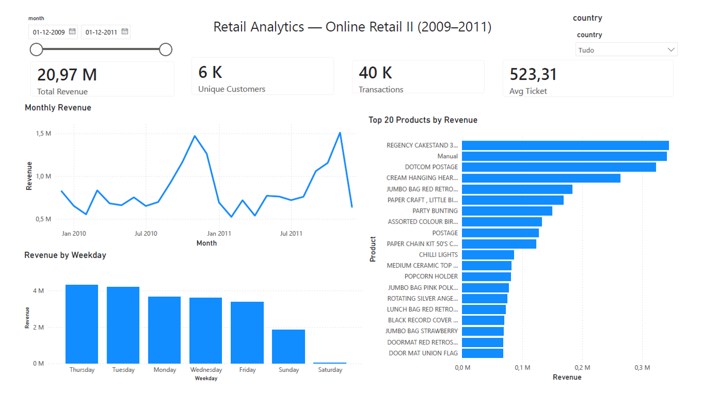
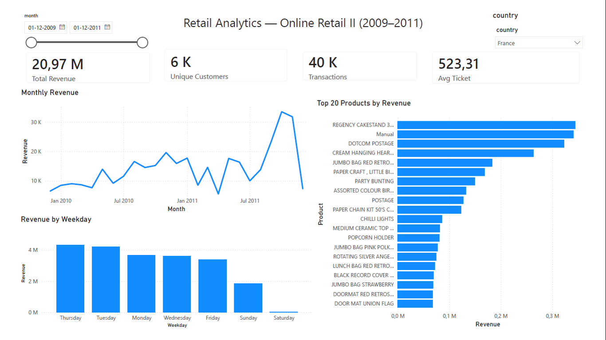
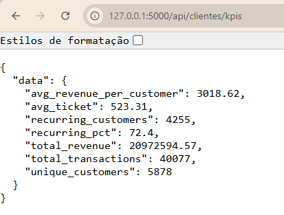

# Retail Analytics — Online Retail II

Sales analytics system that answers three business questions about the Online Retail II dataset (UCI Machine Learning Repository), covering over 1 million transactions between December 2009 and December 2011.

Built with Flask, PostgreSQL and Pandas, exposing a REST API and a Power BI dashboard.

---

## Screenshots



*Filtering by country updates every visual — France shown below.*





---

## Stack

| Layer | Technology |
| :--- | :--- |
| Backend | Flask (application factory, blueprints), SQLAlchemy, Flask-Migrate |
| Database | PostgreSQL 16 |
| Analysis | Pandas |
| Visualisation | Power BI Desktop (DAX measures) |
| Containers | Docker + docker-compose |

---

## Business Questions and Findings

### Question 1 — Geographic Analysis

> *Which top 5 countries generate the most revenue, and what is the monthly sales trend by country?*

**1a. Top countries by revenue**

The United Kingdom dominates the business, generating 85% of total revenue (€17.87M out of ~€21M). Ireland (EIRE) follows with €664,432, the Netherlands with €554,232, Germany with €431,262 and France with €356,944.

Together, the top 5 markets account for roughly 95% of total revenue, leaving the remaining 38 countries sharing about 5%. This represents both an international expansion opportunity and a concentration risk: a downturn in the UK market would disproportionately affect the business.

**1b. Monthly trend**

October and November are consistently the strongest months, while February and April are the weakest. This pattern was confirmed independently in the global aggregation and in individual country timelines, such as France.

---

### Question 2 — Product Analysis

> *Which are the top 20 best-selling products by quantity and by revenue, and which show a declining trend comparing the last 3 months with the previous 3 months?*

**2a. Volume does not equal value**

The best-selling product by units (WORLD WAR 2 GLIDERS, 110,138 units) ranks only 8th by revenue. Conversely, the top revenue generator (REGENCY CAKESTAND 3 TIER) sells four times fewer units but generates thirteen times more revenue.

The practical implication: ranking by quantity and by revenue produces different lists, and the right one depends on the question being asked — inventory planning or profitability.

**2b. Declining products**

Comparing the last 3 months against the previous 3, several products show drops of around −99%. Two readings are possible: product discontinuation, or an artifact of the dataset ending mid-December 2011. Distinguishing between them would require cross-referencing an active product catalogue.

A configurable minimum revenue threshold (`min_receita`, default €100) filters out residual products, preventing statistically meaningless drops — such as a product falling from €5 to €2 — from dominating the results.

---

### Question 3 — Customers and Temporal Patterns

> *What is the average value per transaction and per customer, how many recurring customers are there, and what are the temporal purchasing patterns?*

**3a. Customer metrics**

| Metric | Value |
| :--- | ---: |
| Total revenue | €20,972,595 |
| Transactions (unique invoices) | 40,077 |
| Average ticket per transaction | €523.31 |
| Unique customers | 5,878 |
| Recurring customers | 4,255 (72.4%) |
| Average revenue per customer | €3,018.62 |

**These figures indicate a B2B / wholesale model rather than consumer retail.** An average ticket of €523 and a 72.4% recurrence rate are far above typical B2C retail, where recurrence usually sits around 20–30%.

This reframes every other finding: the October–November peaks reflect wholesalers restocking ahead of the Christmas season, not end-consumer purchases.

Note on methodology: a *transaction* is defined as a unique invoice (`invoice_no`), not a table row. The table's granularity is the sales line, so aggregating at invoice level first is essential — otherwise the average ticket would describe a single line item rather than a purchase.

**3b. Temporal patterns**

By month, revenue peaks sharply in October and November. By weekday, activity is consistent across weekdays and Sundays, but Saturdays record only 30 transactions across two years, compared to roughly 7,000 on other days. This is treated as an operational or recording anomaly, not a demand signal (see Limitations).

---

## Running Locally

**Prerequisites:** Python 3.11+, Docker Desktop.

```bash
# 1. Clone the repository
git clone https://github.com/paulanm01/retail-analytics.git
cd retail-analytics

# 2. Create and activate a virtual environment
python -m venv venv

# Windows
venv\Scripts\activate

# Linux / macOS
source venv/bin/activate

# 3. Install dependencies
pip install -r requirements.txt

# 4. Create the .env file from the template
#    Holds the database credentials, used by both Docker and Flask
cp .env.example .env

# 5. Start PostgreSQL via Docker
docker compose up -d

# 6. Apply database migrations
flask db upgrade

# 7. Run the ETL ingestion script
#    Requires the Online Retail II .xlsx file in data/
python scripts/ingest_data.py

# 8. Start the Flask server
python run.py
```

The API is then available at `http://127.0.0.1:5000`.

> **Note on ports:** the Docker container maps PostgreSQL to port **5433** on the host, to avoid conflicting with a local PostgreSQL installation on the default 5432.

The credentials defined in `.env` are used both by Docker, to create the
database, and by the Flask application, to connect to it. The `.env` file is
not versioned — `.env.example` holds the structure with placeholder values.

---

## API Endpoints

| Method | Endpoint | Description | Parameters |
| :--- | :--- | :--- | :--- |
| `GET` | `/health` | Application and database health check | — |
| `GET` | `/api/vendas/por-pais` | Top N countries by total revenue | `?top=5` (default 5) |
| `GET` | `/api/vendas/timeline-por-pais` | Monthly revenue evolution for one country | `?pais=France` (**required**) |
| `GET` | `/api/produtos/top` | Top N products by revenue or quantity | `?por=receita\|quantidade&limite=20` |
| `GET` | `/api/produtos/tendencias-queda` | Products with the steepest decline, last 90 days vs previous 90 | `?limite=20&min_receita=100` |
| `GET` | `/api/clientes/kpis` | Customer metrics (average ticket, recurrence rate, etc.) | — |
| `GET` | `/api/vendas/padroes-temporais` | Revenue and transactions by weekday and by month | — |

**Example**

```bash
curl "http://127.0.0.1:5000/api/vendas/por-pais?top=3"
```

```json
{
  "data": [
    { "country": "United Kingdom", "revenue": 17870977.78 },
    { "country": "EIRE", "revenue": 664431.78 },
    { "country": "Netherlands", "revenue": 554232.34 }
  ]
}
```

Endpoint paths follow the Portuguese naming defined in the project specification, while all internal code, variables and JSON keys use English.

---

## Architecture

```
Excel file  ──>  ingest_data.py  ──>  PostgreSQL  ──>  analytics.py  ──>  Flask API  ──>  client
                 (ETL, batches         (Docker)         (Pandas)          (7 endpoints)
                  of 5,000 rows)            │
                                            └────────────────────────────────────────>  Power BI
```

Power BI connects directly to PostgreSQL rather than through the REST API, since it is optimised for querying databases with its own aggregation engine.

**Module organisation**

- `models/` — SQLAlchemy ORM definitions (single `Transaction` table)
- `services/` — analysis logic (`analytics.py`), isolated from HTTP
- `routes/` — REST endpoints: request handling, parameter validation, JSON responses
- `scripts/` — standalone ETL and verification scripts
- `migrations/` — Alembic migration history

This separation allows the analysis functions to be tested directly in `flask shell`, without running a server — which isolates calculation errors from HTTP errors.

---

## Technical Decisions

| Decision | Rationale | Trade-off |
| :--- | :--- | :--- |
| **Single denormalised table** | Purely analytical workload: aggregated reads, no frequent inserts or updates. Normalisation would add joins and complexity without practical benefit. | No relational integrity between products and transactions; product descriptions are repeated across rows. |
| **Excluding returns (invoices starting with "C")** | The business questions concern revenue actually generated. Returns would mix two different phenomena in the same metric. | Loses visibility over return rates by product — a valid question, but out of scope here. |
| **ETL rather than ELT** | With ~1M rows, in-memory transformation was viable and guaranteed only validated data reached the database. | Less flexibility than keeping raw data available for reprocessing. At tens of millions of rows, ELT with SQL transformations would be preferable. |
| **Batch ingestion (5,000 rows)** | Avoids memory spikes and commits per batch, so a mid-run failure does not lose already-persisted data. | Slightly more complex write logic than a single bulk insert. |
| **Aggregations in Pandas, not SQL** | Gave more flexibility for chained transformations and kept the analysis logic in one place. | Loads the dataset into memory on each request. In production, aggregations would be pushed to SQL `GROUP BY` or a pre-aggregated table. |
| **`Float` instead of `Numeric` for prices** | The project performs aggregate analysis, where sub-cent rounding differences do not affect conclusions. | Not suitable for financial reporting. Rounding is applied only after aggregation, so errors do not accumulate across the ~1M rows. |
| **Parameterised SQL queries** | Values are passed via `params={}` rather than string interpolation, preventing SQL injection. | None. |

---

## Limitations and Detected Anomalies

1. **Service codes among top revenue generators (`M`, `DOT`)** — the 2nd and 3rd highest revenue entries are not products: `M` denotes manual adjustments (€340,716) and `DOT` denotes postage (€322,657). They were kept in the dataset for transparency, but should be filtered out in a strict product-level analysis.

2. **Saturday recording anomaly** — only 30 transactions across two years, against roughly 7,000 on every other day, while Sunday operates normally. This points to an operational or recording particularity rather than absence of demand, and would need confirmation from the business before drawing conclusions about strong and weak days.

3. **Incomplete final month** — the dataset ends on 9 December 2011. The final period is therefore partial, which compresses recent revenue and exaggerates decline percentages in trend analysis.

4. **Steep declines (~99%)** — likely reflect product discontinuation or the incomplete final period described above. Distinguishing between the two would require an active product catalogue.

---

## Future Improvements

- Automated unit and integration tests with `pytest`
- Moving heavy aggregations to SQL views or materialised views
- A configurable cleaning layer to exclude non-product codes (`M`, `DOT`, `POST`)
- Caching for the heaviest endpoints
- Pagination on list endpoints

---

## Dataset

Online Retail II — UCI Machine Learning Repository
https://archive.ics.uci.edu/dataset/502/online+retail+ii

Transactions from a UK-based online retailer between 01/12/2009 and 09/12/2011. After cleaning (removing returns, null identifiers and non-positive quantities or prices), 1,041,670 rows were loaded.